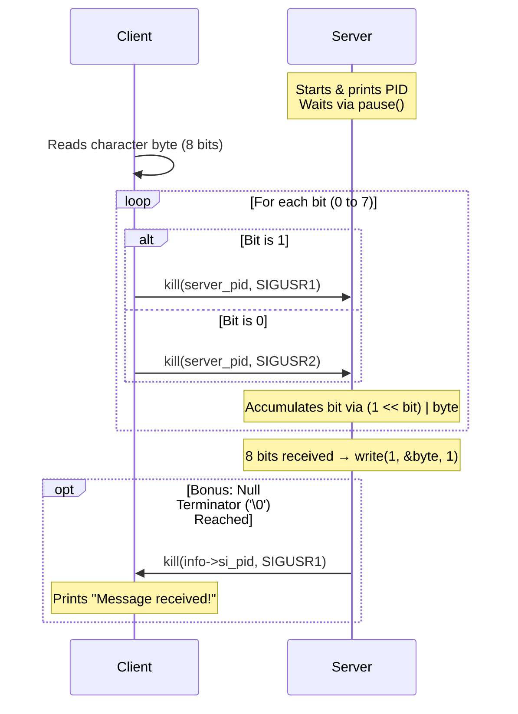

# Minitalk — UNIX Signal-Based Inter-Process Communication


**Minitalk** is a compact client-server communication system written in C that transmits arbitrary text data between two independent processes using **only UNIX signals** (`SIGUSR1` and `SIGUSR2`). Developed as part of the [42 School](https://42.fr/) systems programming curriculum, this project explores low-level Inter-Process Communication (IPC), bitwise serialization, and asynchronous signal handling.

---

## Key Technical Concepts

- **Asynchronous IPC via UNIX Signals:** Establishing reliable data transfer using only two user-defined signals (`SIGUSR1` and `SIGUSR2`) without shared memory, sockets, or pipes.
- **Bitwise Serialization & Deserialization:** Deconstructing characters into 8 individual bits on the client side using bitwise right-shifts (`>>`) and masks (`& 1`), and reconstructing bytes on the server side via bitwise left-shifts (`<<`) and OR (`|`) operations.
- **Signal Handling (`signal` vs. `sigaction`):**
  - **Mandatory Implementation:** Uses standard `signal()` handlers to intercept and decode incoming bitstreams.
  - **Bonus Implementation:** Uses `sigaction()` with `SA_SIGINFO` to inspect sender metadata (`siginfo_t->si_pid`), enabling bidirectional communication so the server can send a delivery acknowledgment signal back to the client.
- **Unicode / Multi-Byte Support:** Since characters are serialized at the byte level, multi-byte UTF-8 characters (such as emojis and international scripts) are reconstructed seamlessly on the server.

---

## How It Works



1. **Server Initialization:** The server starts, retrieves its Process ID via `getpid()`, prints it to standard output, and enters an infinite `pause()` loop waiting for incoming signals.
2. **Bitwise Transmission:** The client parses the target server PID and iterates through each character of the message string. For every character, it inspects bits `0` through `7` (Least Significant Bit first):
   - Sends `SIGUSR1` if the bit is `1`
   - Sends `SIGUSR2` if the bit is `0`
3. **Byte Reconstruction:** The server maintains `static` state across signal invocations (`bits` counter and `final_msg` accumulator). Once 8 bits are collected, the reconstructed byte is written directly to `stdout` using `write()`.
4. **Delivery Acknowledgment (Bonus):** When the client finishes sending the message, it transmits a null-terminating byte (`\0`). Upon decoding `\0`, the bonus server extracts the client's PID from `siginfo_t->si_pid` and signals `SIGUSR1` back to the client, confirming end-to-end delivery.

---

## Project Structure

```text
minitalk/
├── Makefile                    # Build system for mandatory and bonus targets
├── includes/
│   ├── minitalk.h              # Mandatory header file
│   ├── minitalk_bonus.h        # Bonus header file
│   └── ft_printf.h             # Custom printf header
├── libft/                      # Custom C standard library & ft_printf
└── src/
    ├── mandatory/
    │   ├── client.c            # Basic signal transmitter
    │   └── server.c            # Basic signal receiver using signal()
    └── bonus/
        ├── client_bonus.c      # Transmitter with delivery confirmation handler
        └── server_bonus.c      # Receiver using sigaction() & client PID tracking
```

---

## Getting Started

### Prerequisites

- A UNIX-based operating system (Linux or macOS)
- `cc` (`gcc` or `clang`) compiler
- `make`

### Compilation

Clone the repository and compile the executables using `make`:

```bash
git clone https://github.com/mateusgpedro/minitalk.git
cd minitalk
```

- **Compile Mandatory Version (`client` & `server`):**
  ```bash
  make
  ```

- **Compile Bonus Version (`client_bonus` & `server_bonus`):**
  ```bash
  make bonus
  ```

- **Clean Build Artifacts:**
  ```bash
  make clean    # Removes object (.o) files
  make fclean   # Removes object files, libraries (.a), and executables
  make re       # Rebuilds everything from scratch
  ```

---

## Usage

### 1. Mandatory Mode

Start the server in one terminal window:

```bash
./server
# Output: PID: 48291
```

In a second terminal window, run the client with the server's PID and the message you want to send:

```bash
./client 48291 "Hello from Minitalk!"
```

### 2. Bonus Mode (With Delivery Acknowledgment & Unicode)

Start the bonus server:

```bash
./server_bonus
# Output: PID: 48350
```

Send a message using the bonus client:

```bash
./client_bonus 48350 "Hello World! 🚀🔥"
# Client Output: Message received!
```
